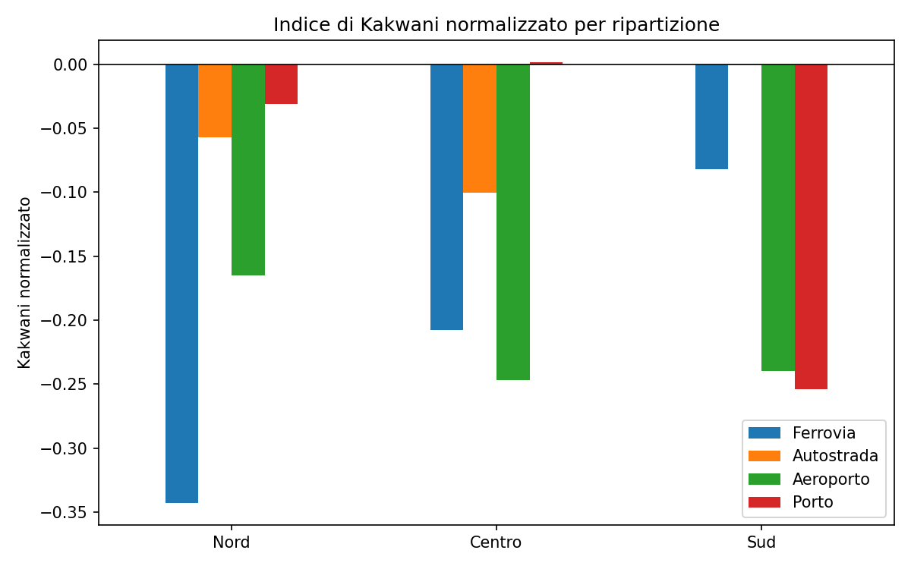
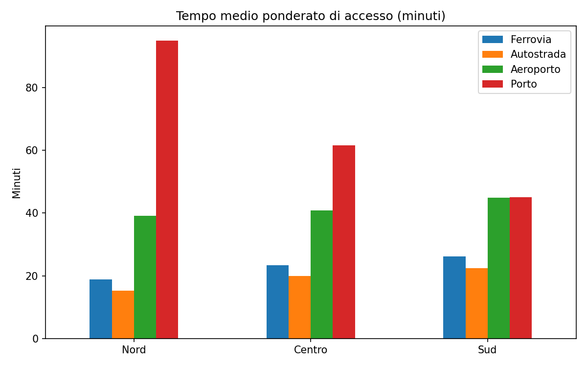
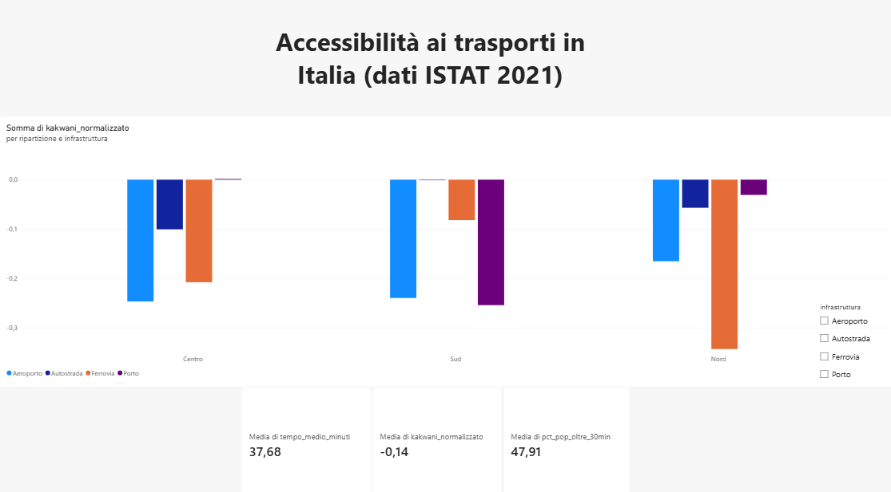
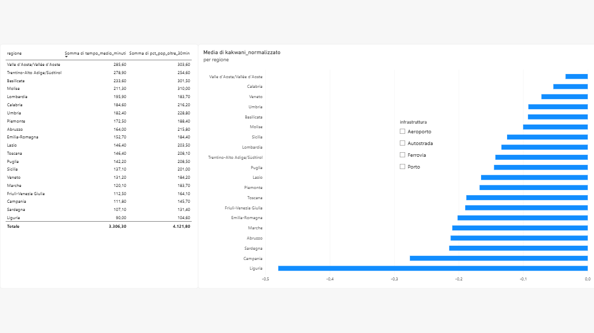

# Accessibilità alle infrastrutture di trasporto in Italia

Analisi dell'equità territoriale nell'accesso a **stazioni ferroviarie, accessi autostradali, aeroporti e porti passeggeri**, a livello comunale, con l'**indice di Gini** e l'**indice di Kakwani**.
Il progetto riprende il tema della mia tesi di laurea in Statistica e Big Data (Università Mercatorum, 2026): per la tesi ho lavorato su un dataset fornito dal relatore, qui ho rifatto l'analisi partendo dal file ufficiale ISTAT.

## Obiettivo
Confrontare la concentrazione della popolazione con quella dei costi di accesso (minuti di percorrenza verso la prima infrastruttura disponibile) per misurare gli squilibri territoriali, a livello nazionale, per ripartizione (Nord/Centro/Sud) e per regione.

## Dati
Fonte: **ISTAT**, *Matrice degli indici di accessibilità dei comuni alle principali infrastrutture di trasporto* (foglio "Accessibilità comuni", 7.917 comuni): popolazione censuaria al 31.12.2021 e tempi minimi di percorrenza in minuti verso stazione ferroviaria, accesso autostradale, aeroporto e porto passeggeri.
Il file originale è nella cartella `data/`. Dati ISTAT, riutilizzati citando la fonte.

## Metodo
1. Minuti totali per comune = popolazione × tempo minimo di accesso.
2. Gini della popolazione e Gini dei minuti totali, per ciascuna infrastruttura.
3. Indice di Kakwani normalizzato = (Gini tempi − Gini popolazione) / (1 − Gini popolazione).
   - 0: costo di accesso distribuito come la popolazione
   - > 0: costo di accesso più concentrato della popolazione (squilibrio territoriale)
   - < 0: costo di accesso meno concentrato della popolazione

## Struttura
- `src/analisi.py`: pulizia dati, indici, tabelle in `output/`, database SQLite
- `sql/query.sql`: query di analisi sul database
- `powerbi/`: CSV pronti per Power BI, dashboard e screenshot 
- `output/`: tabelle (CSV), cartella Excel `risultati_progetto.xlsx`, grafici

## Come eseguirlo
```
pip install -r requirements.txt
python src/analisi.py
```
Richiede Python 3.10+. Lo script legge il file in `data/` e rigenera tabelle, grafici, file Excel, database SQLite, CSV per Power BI e questa sezione di risultati.

## Risultati principali
<!-- RISULTATI -->
**Indice di Kakwani normalizzato** (> 0: costo di accesso più concentrato della popolazione; < 0: meno concentrato).

| Area | Gini popolazione | Ferrovia | Autostrada | Aeroporto | Porto |
|---|---|---|---|---|---|
| Italia | 0.718 | -0.193 | -0.007 | -0.194 | -0.083 |
| Nord | 0.703 | -0.343 | -0.057 | -0.165 | -0.031 |
| Centro | 0.735 | -0.208 | -0.100 | -0.247 | 0.002 |
| Sud | 0.713 | -0.082 | -0.001 | -0.239 | -0.254 |




<!-- /RISULTATI -->




## Strumenti
Python (Pandas, NumPy), SQL (SQLite), Power BI, Excel.

## Autrice
Denise Faccia · [LinkedIn](https://linkedin.com/in/denise-faccia)
